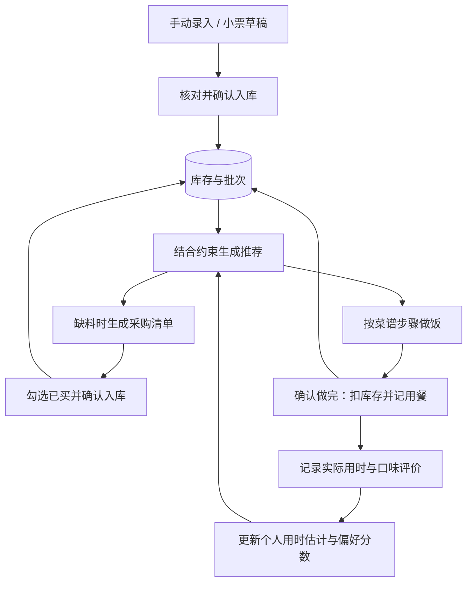

# SoloMeal

面向一人食场景的智能厨房管理应用，把「家里有什么、这顿吃什么、缺什么、做完后还剩什么」串成一个可追踪的闭环。

SoloMeal 使用 React、FastAPI 和 MySQL 构建独立 Web 应用。模型负责理解自然语言、提取小票和生成菜谱草稿；规则引擎负责推荐与计算；数据库事务负责真实的库存变化。用餐记录、实际用时和用户评价继续影响下一次推荐。

> 当前已交付库存、推荐、采购、做饭、撤销和反馈流程，以及 F1～F8 功能扩展。模型能力按配置启用；功能审查与模型效果评测分别记录。本文按「业务问题 → 技术选型 → 具体方案 → 验证结果」介绍项目。

## 1. 业务问题：让一次吃饭决策真正落到厨房里

对独自做饭的人来说，困难往往贯穿整顿饭，而不只是在找一道菜。

| 业务问题 | 系统需要做到什么 |
| --- | --- |
| 买完菜后忘了家里还有什么，小票又需要逐项录入 | 汇集手动录入和小票信息，保留批次、数量、位置与到期提醒 |
| 菜谱看起来合适，实际却缺材料、厨具或时间 | 结合库存、忌口、厨具、可用时间与补购预算筛选，解释推荐原因 |
| 缺一点食材却要买一整包，预算容易算错 | 按真实缺口与包装报价计算采购量，区分已知费用和未知报价 |
| 做完饭后库存没有变化，点错或重试又可能重复扣减 | 确认做完才记账；库存与用餐记录一起提交，支持按实际消耗撤销 |
| 每次推荐都从零开始，忽略做饭速度和口味反馈 | 用历史用时、收藏、喜欢／不喜欢和近期用餐记录调整后续推荐 |

项目目标是让一餐从「决定吃什么」走到「库存和历史正确更新」，并积累下一餐可以使用的数据。节省录入时间、减少浪费是产品目标，目前尚无大规模真实用户数据量化这些收益。

## 2. 技术选型：为业务约束与可靠执行服务

| 技术选择 | 对应问题与选择理由 |
| --- | --- |
| **React + TypeScript + Vite** | 将库存、可编辑草稿、推荐、采购和做饭步骤组织成可操作页面；用类型检查约束前后端数据交互 |
| **FastAPI + Pydantic** | 将数量、单位、份数、约束和工具参数定义成明确契约；模型输出与用户输入都必须经过校验 |
| **MySQL + SQLAlchemy + Alembic** | 保存多用户业务数据、方案版本和执行状态；通过事务与锁处理库存扣减，使用迁移管理结构演进 |
| **确定性推荐与统计规则** | 让库存覆盖、临期优先、重复惩罚、包装费用和个性化分数可以解释、复算和测试 |
| **可配置的聊天／视觉模型** | 处理自然语言意图、小票字段提取和菜谱生成；支持 native／JSON 工具协议，结构化结果交给服务端校验 |
| **显式单 Agent 状态机** | 保存执行轮次、待确认动作、租约和终态，使暂停、取消、冲突与恢复都有明确边界 |
| **持久化事件 + SSE** | 将运行状态同步到页面；断线后通过事件游标补收，避免旧状态覆盖新状态 |
| **Docker Compose + Nginx** | 统一 Web、API、数据库与迁移的启动顺序；提供同源入口、分组限流和独立持久化卷 |
| **pytest + Node Test + Playwright + GitHub Actions** | 分别验证服务端规则、前端状态处理、完整用户流程和真实 MySQL 行为 |

独立应用的数据库是业务事实来源。模型调用期间不持有数据库锁，库存修改由短事务完成；模型不能直接访问数据库、执行任意 Shell 或绕过工具白名单。

架构与决策细节见 [架构说明](docs/architecture.md)、[Agent 运行机制](docs/agent.md)和[推荐与方案契约](docs/planning.md)。

## 3. 具体方案：从输入到执行，再让数据回到推荐

### 3.1 一餐的业务闭环



| 环节 | 已实现的行为 |
| --- | --- |
| **录入与库存** | 手动管理食材、批次与别名；小票图片生成可编辑草稿，逐行核对后整单入库；不明确的量保留为待确认信息 |
| **菜谱与发现** | 手工维护菜谱；用户触发模型生成候选，编辑并校验草稿后加入个人菜谱；可显式导入三道原创示例菜谱 |
| **推荐与选择** | 先检查忌口、厨具、时间和预算条件，再按库存、临期、近期重复和偏好排序；支持清库存、快速做、少采购、换口味等场景及「换一道」 |
| **报价与采购** | 使用用户保存的包装报价，按缺口向上取整；支持多菜合并采购、已买勾选、整单确认入库与关闭清单 |
| **做饭与撤销** | 展示步骤、提供计时、记录实际用时；确认做完后一次性扣库存并写历史，撤销按批次消耗明细恢复 |
| **反馈与首页** | 收藏与喜欢／不喜欢分别保存；「今天」汇集优先处理、今天推荐、待采购、最近做过四块内容，支持局部失败和重试 |

推荐、草稿、计时和「已买」勾选都有各自的状态：推荐不会预扣库存，小票与菜谱草稿需要确认，采购勾选也要经过整单确认才入库。

### 3.2 「智能」如何产生，并回到下一次决策

**自然语言入口。** Agent 查询用户的真实库存、菜谱、报价与用餐记录，再调用受控工具给出建议。新增库存、确认做饭和撤销等业务写入先生成预览，用户确认后由同一业务服务执行。

**可解释的推荐。** 推荐返回约束、缺料、分项评分、报价来源和原因。未知或过期报价会标记为未知，不会被当成「预算已满足」。首页加载与规则推荐均不调用模型。

**数据反馈。** 实际用时按相同菜谱版本、相同份数取近期样本，用中位数与标准用时加权估计；偏好排序结合收藏、喜欢／不喜欢，以及近期做过的食材和烹饪方式。样本窗口、权重和分数上限由固定规则定义，可以关闭并复算。

这里已经形成基于业务记录的推荐反馈闭环。当前个性化使用统计与规则，尚未进行模型训练；自动化外部数据采集与定期汇总仍是后续方向。

### 3.3 将可靠性落实到具体动作

- **事务与幂等：** 做饭、撤销和采购确认绑定用户、请求与幂等键。服务端已提交但响应丢失时，同键重试返回原结果，防止重复扣减或入库。
- **版本与新鲜度：** 方案保存约束和数据快照；库存、菜谱或相关条件变化后，旧方案不能直接确认，需要重新计算和复核。
- **身份与文件边界：** 用户身份取自服务端认证，跨用户对象访问被拒绝；小票图片保存在私有卷，经鉴权访问，密钥留在后端配置中。
- **执行状态恢复：** Agent 保存状态与事件序号，SSE 按游标补收；已取消或已过期的动作不能再确认，页面按事件顺序同步状态。
- **页面恢复：** 未决采购请求在切页后保留原请求和幂等键；首页首次加载失败提供明确重试入口；慢响应不会覆盖已编辑条件或较新的请求结果。

### 3.4 本地运行

需要 **Docker Engine、Docker Compose 和 Python 3.12+**。以下示例创建独立项目，配置文件放在仓库外，使用端口 `18090`：

```bash
git clone https://github.com/xpzzzzz/SoloMeal.git
cd SoloMeal
python deploy/manage.py init --env-file ../solomeal-private/local.env --port 18090
docker compose --env-file ../solomeal-private/local.env -p solomeal-local up -d --build --wait --wait-timeout 180
```

访问 `http://127.0.0.1:18090`，注册账号后可录入库存、导入示例菜谱并体验业务流程。初始化脚本生成数据库密码且拒绝覆盖已有配置文件；数据库与私有图片分别保存在项目持久化卷中。

模型能力默认关闭，手动流程仍可使用。启用模型时配置 `SOLOMEAL_MODEL_BASE_URL`、`SOLOMEAL_MODEL_NAME`、`SOLOMEAL_MODEL_API_KEY` 与工具协议，并按需开启：

| 开关 | 能力 |
| --- | --- |
| `SOLOMEAL_AGENT_ENABLED` | 模型对话与工具执行 |
| `SOLOMEAL_RECEIPT_VISION_ENABLED` | 小票视觉解析 |
| `SOLOMEAL_RECIPE_DISCOVERY_ENABLED` | 菜谱候选生成 |

完整部署、模型参数、联合备份与恢复步骤见 [部署指南](deploy/README.md)。开发环境见 [后端说明](backend/README.md)；前端可在 `frontend/` 下运行 `npm ci`、`npm test` 和 `npm run e2e`。新克隆可执行 `git config core.hooksPath .githooks` 启用提交钩子。

## 4. 验证结果：逐项对应方案，保留适用范围

### 4.1 工程与用户流程验证

以下是已有验证记录，各行保留对应批次与范围，不将不同阶段的测试数量相加。功能阶段 F1～F8 已完成审查；完整记录见 [功能执行记录](docs/feature-expansion-progress.md)。

| 验证对象 | 结果 | 证明范围与证据 |
| --- | --- | --- |
| 后端规则与接口 | 2026-09-23 F8 批次 **645 通过、16 MySQL 专属测试跳过** | 本地全量后端结果；不能将跳过项算为真实 MySQL 通过。见 [F8 验证记录](docs/feature-expansion-progress.md#f8-今天首页2026-09-23开发-agent) |
| 前端状态与完整流程 | 同批次 **68/68 单测**、TypeScript/Vite 构建通过、**38/38 浏览器夹具流程** | 覆盖网络、会话和业务操作；夹具采用脚本模型，不代表真实模型效果。见 [功能执行记录](docs/feature-expansion-progress.md) |
| 首页错误恢复 | F8 R1 本地三条流程 **3/3**；真实预览首次断连恢复 **1/1**、推荐条件保护 **1/1** | 验证失败后可恢复四栏，并保留已编辑推荐条件。见 [F8 R1 记录](docs/feature-expansion-progress.md#f8-r1-修复与主审查结论2026-09-23) |
| 真实小票到库存 | receipt-v5 下三张真实调试小票字段与页面核对通过，人工修正、整单确认、同键丢包重试通过 | 特定 Qwen 配置、特定样本的验证；三张已用于调试，不是独立留出或通用 OCR 准确率。见 [小票验收报告](docs/validation/receipt-v5-acceptance-0909.md) |
| 业务写入断线恢复 | 做饭提交后丢响应，同键重试库存保持 **220g**；撤销丢响应再重试保持 **300g**，均只应用一次 | 在真实 Compose 堆栈注入请求断连，验证库存与事件一致性。见 [受控弱网报告](docs/validation/p9-weaknet-0917.md) |
| Agent 状态同步 | 真实模型 API/SSE 与浏览器断线场景完成恢复验证 | 覆盖记录中的执行与事件补收路径，尚非所有异常场景。见 [API/SSE 报告](docs/validation/p9-agent-weaknet-0917.md)、[浏览器报告](docs/validation/p9-agent-ui-weaknet-0917.md) |
| 数据与私有图片恢复 | 独立本地 MySQL 环境完成 SQL 与私有图片联合恢复，核对业务快照、原图字节和幂等重放 | 同一物理主机上的独立项目验证。见 [联合恢复报告](docs/validation/deployment-restore-0916.md) |
| GitHub CI | 应用基线 **`3d9ee1e`** 的 **9 个作业全部成功**，含真实 MySQL、SQLite 回退、前端、浏览器和 `ci-complete` | 结果绑定该提交。见 [对应 Actions 运行](https://github.com/xpzzzzz/SoloMeal/actions/runs/35881468133) |

### 4.2 Agent 是否比直接聊天更能完成任务

历史 v19 配置的合成评测，比较了工具 Agent、固定流程与直接模型。对 Agent 和直接模型都适用的 **14 个场景、每场景 3 次，共 42 次配对运行**：

| 模式 | 任务完成次数 | 成功率 |
| --- | --- | --- |
| 工具 Agent | 32/42 | 76.2% |
| 直接模型 | 26/42 | 61.9% |

在这组给定配置和合成任务中，工具 Agent 的任务成功率高 **14.3 个百分点**。任务完成包含客观检查与 Codex 语义评审，三次重复共享同题，不是 42 个独立场景。计算口径、配对结果与限制见 [离线复算报告](docs/validation/resume-agent-comparison-0923.md)。

同一历史批次的全部 **20 个场景 × 3 次**，Agent 为 **48/60＝80%**，**未达 85% 验收门槛**；独立人工清晰度为 `null`。后续对已暴露场景的修复回归不替换该分数。这组结果不能外推为当前 F1～F8 的整体效果或真实用户成功率。见 [原始合成留出报告](docs/validation/p8-cohort-v19-holdout-0914.md)。

### 4.3 当前边界与下一步

- 历史浏览器压力复验中，9 轮共 180 次场景运行有 **4 次首导航超时失败**，原 30 秒停顿根因尚未闭合；单轮全绿不能证明套件没有偶发失败。见 [压力复验与证据复算](docs/validation/e2e-stress-0918.md)。
- 已验证本地部署与选定恢复路径；全新物理主机、公网部署及完整发布验收仍有独立工作，当前不宣称生产上线。见 [验收清单](docs/validation/final-acceptance-checklist-0917.md)。
- 当前库存仍使用结构化数量与单位；菜谱发现为用户触发的候选生成，基础示例有三道。更连贯的 UI、约数表达、更丰富的菜谱与图片、自动化数据采集和周期汇总属于后续方向；F9 日历统计暂缓。

## 代码与文档

| 目录／文档 | 内容 |
| --- | --- |
| [`backend/`](backend/) | FastAPI 服务、业务规则、模型适配与数据库迁移 |
| [`frontend/`](frontend/) | React 界面、前端测试与 Playwright 流程 |
| [`deploy/`](deploy/) | Compose、Nginx、部署与联合备份恢复工具 |
| [`evaluation/`](evaluation/) | 评测协议、执行与指标工具 |
| [功能执行记录](docs/feature-expansion-progress.md) | F1～F8 实现、修复、审查及验证范围 |
| [项目状态](SOLOMEAL_STATUS.md) | 历史阶段状态与证据索引 |

SoloMeal 基于 [sergiparpal/meal-manager](https://github.com/sergiparpal/meal-manager) 演进。原 Hermes 插件保留在 `src/`、`__init__.py` 和 `plugin.yaml` 中，其标准库／JSON 存储与独立 Web 应用分别维护；插件使用说明见 [skill.md](skill.md)，复用边界见 [上游审查与复用矩阵](docs/upstream.md)。

项目保留 **GPL-3.0** 许可，见 [LICENSE](LICENSE)。
