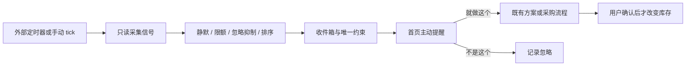

# 主动提醒 M1

主动提醒把“什么时候值得说”限定为可回放的规则。采集和排序不调用模型；用户接受提醒只改变提醒状态，方案保存、做饭确认和采购仍使用已有业务接口及其版本、幂等校验。



| 信号 | 条件 | 优先级 | 内容依据 |
|---|---|---:|---|
| 临期批次 | 未归档、数量大于零，上海日期为今天或明天 | 今天 90、明天 80 | 批次、食材和关联菜谱；无菜谱也提醒并打开库存 |
| 采购草稿滞留 | 草稿创建至少 48 小时，且至少一项未勾选 | 50 | 清单创建时间和未勾选项数 |

过期批次和三天后到期的批次不属于本阶段采集窗口。文案不声称菜谱一定用完食材，也不虚构近期使用历史。

默认每天最多产生 1 条（设置范围 1～3）；默认静默时间为上海时间 22:00 至次日 08:00。`quiet_start` 等于 `quiet_end` 表示不设置静默窗口。关闭开关、延后提醒、静默窗口与每日剩余额度都在选取时生效。按优先级降序排序，同优先级优先处理较早过期的条目。

同一类型最近三次接受或忽略结果若连续三次都是忽略，则从最后一次忽略起 7 天内抑制该类型；接受会中断连续忽略。用户点击“以后别推这类”记作一次 `too_often` 忽略，仍遵循三次规则，并非立即永久屏蔽。

日期桶按上海日历计算；应用与数据库之间将无时区数据库值视为 UTC。按用户、信号和日期的唯一键防止重复，同一用户每天的名额也有唯一约束，以限制并发 tick 选择不同对象时突破上限。冲突的插入跳过，后续定时 tick 可以再尝试剩余机会。单个批次或清单的版本发生改变后，接受返回 `PROACTIVE_STALE`；用户应回到原业务页面核对，或等待新的日期桶重新计算。

接受提醒后，服务端保留“已接受、动作未完成”的状态；关闭或重新打开浏览器后，首页提供“继续处理”或“不再继续”。方案创建键由提醒 ID 固定生成，响应丢失后重试会复用既有结果。完成动作后才将提醒从收件箱移除；放弃继续不会增加忽略次数。迁移时已在旧版标记为接受的提醒按历史完成处理，避免重新推送旧记录。

## 运行和配置

先在隔离环境应用迁移。`SOLOMEAL_TICK_TOKEN` 默认未设置，未设置时 `/internal/tick` 返回 404；设置后使用 `X-Internal-Token` 发起 `POST /internal/tick`，可传 `{}` 或带 `user_id` 的 JSON。按用户选择，该受令牌保护的内部触发器不使用用户登录态或 `Idempotency-Key`；重复调度由信号和名额唯一约束控制，返回的计数反映每次实际执行结果。普通业务接口的接受、忽略、设置修改及演示时间推进使用既有 `Idempotency-Key` 校验和重放机制。

也可以在具备数据库访问权限的应用主机上运行：

```bash
python -m app.commands.tick
python -m app.commands.tick --user-id <用户UUID>
```

命令会对所配置数据库写入提醒；外部 cron 需自行配置，应用不会自动启动定时器。不要将演示开关或内部令牌暴露到不受控环境。

本机 Compose 部署可叠加 `deploy/proactivity.compose.yaml`，启动独立的 `proactivity-tick` 服务。该服务启动时运行一次，随后每小时运行一次，容器重启时再次运行；它只使用数据库连接，不调用模型。仍需确保数据库已健康且迁移已完成：

```powershell
docker compose --env-file <私有配置文件> -p <项目名> -f compose.yaml -f deploy/proactivity.compose.yaml up -d --no-build --no-deps proactivity-tick
```

定时器日志仅输出执行时间和计数；失败时记录通用错误并在下一次周期重试。Docker 停止期间不会执行，恢复后从启动时刻重新开始，不能视为严格按整点执行的任务。

`SOLOMEAL_DEMO_MODE=true` 时才注册 `/api/v1/proactivity/simulate` 和显示首页“推进 1 天”按钮。模拟时间只属于当前进程和当前用户，不修改系统时钟；它会按新时间运行一次该用户的 tick。重启或跨进程不会共享偏移，因此只适合本地演示。演示时也遵守静默和每日限额。

## 指标

- 创建数：tick 返回的 `created`，表示本次成功写入的条目数；重复或名额冲突不计入。
- 过期数：tick 返回的 `expired`，表示本次从 pending 转为 expired 的条目数。
- 抑制数：tick 返回的 `suppressed`，为各用户被抑制信号类型数之和，不是被丢弃的条目数。
- 接受率、忽略率：可分别用已接受、已忽略条目数除以同一时间窗口的创建条目数；窗口未结束的 pending 仍在分母中，解释时应注明。
- M1 不记录首次展示时间，`delivered_at` 保留为空，因此不把创建数当成已曝光数，也不计算曝光转化率。

## 本地演示（约 90 秒）

1. 在隔离演示环境开启 demo mode、配置 tick token；建立明天到期的菠菜批次及引用菠菜的菜谱，并让用户具备菜谱所需厨具。
2. 在上海日间运行一次 tick，打开或刷新首页，看到“菠菜……明天到期”以及可做的菜谱；展开“为什么是现在”查看日期和菜谱数量。
3. 点击“就做这个”，在“我的菜谱 → 待做餐食”确认做完。确认前库存不变，确认成功后库存扣减并出现用餐记录。
4. 准备一张超过 48 小时且仍有未勾选项的采购草稿，点击“推进 1 天”，或由外部调度运行 tick；注意每日额度和静默时段可能影响出现时间。
5. 连续三次在不同日期生成并忽略同类提醒，可观察收件箱 `suppressed_kinds` 中出现该类型；最后一次忽略后的 7 天内不会再生成该类提醒。

后续 M2 可预生成方案草稿；M3 可物化长期画像；M4 可研究个人活跃时段；Web Push 或邮件摘要属于另行设计的渠道。
