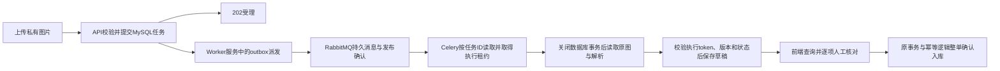

# M3：Celery + RabbitMQ 异步小票正常链路

M3已完成：正常链路、真实页面、MySQL/SQLite回归均通过，按连续授权进入M4。真实模型调用0，OCR未引入，原18080/18088未替换。

## 实现及状态

`POST /api/v1/receipts/{id}/parse` 改为202受理，返回小票当前状态与 `parse_task_id`。GET详情/列表沿用原认证与用户隔离。历史识别不重新投递；旧parsing记录仍保留原120秒过期提示。新任务有独立15分钟总截止时间。

受理继续使用原 `run_operation`、用户行锁、版本、每小票一次受理和滚动24小时10份限额。在同一事务中保存操作、小票queued状态及 `receipt_parse_tasks`。相同操作键重试读取当前状态，不增加任务。任务表同时作为持久outbox，保存派发时间、发布租约和执行状态；没有API进程内待执行列表，也没有Redis结果后端。

任务状态为queued→running→succeeded/failed/discarded，临时解析故障可回到queued等待有限重试。对应小票为queued/parsing/parsed/failed/discarded，重试等待显示retrying。一次受理最多3次执行，默认单Worker并发1、预取1、外部解析超时30秒、Celery硬上限90秒、执行租约120秒、总截止900秒。过期执行权可换新token，旧执行结果不能提交。发布确认丢失后可重新派发；不能据此声称外部模型恰好调用一次。

派发前后各用短事务，发送到RabbitMQ期间不持数据库连接；Worker解析期间也不持连接或用户行锁。消息仅含任务UUID，原图通过只读共享上传卷读取，结果只存MySQL。实际解析器继续使用原Schema、单位、别名归属及草稿业务规则，所有识别行均强制需要人工核对。编辑/取消在原事务中废止旧执行权，确认入库仍用原整单原子事务。

`worker`同一服务内监管outbox和Celery两个进程，任一退出即结束服务，Compose负责重启。持久quorum业务队列 `solomeal.receipts`、消息delivery_mode2、confirm_publish、late ack及worker lost重投配置参照 [Celery配置](https://docs.celeryq.dev/en/stable/userguide/configuration.html) 与 [RabbitMQ确认机制](https://www.rabbitmq.com/docs/confirms)。本地仅一个RabbitMQ节点，没有复制集高可用保证。Celery会创建内部延迟/事件队列，它们不是库存结果存储。

Windows开发使用Linux Docker Worker；Celery官方不支持原生Windows Worker，见 [官方FAQ](https://docs.celeryq.dev/en/stable/faq.html#does-celery-support-windows)。本阶段锁定Celery5.6.3/Kombu5.6.2及其依赖、RabbitMQ4.2.7镜像digest；不安装OCR/GPU依赖。

## 前端、部署与备份

原ReceiptPanel增加排队/识别/有限重试/失败状态；可手动刷新，每2秒轮询、单轮最多5分钟、隐藏页面暂停。刷新/重新登录通过服务端状态恢复。编辑器保持稳定身份，后台状态刷新不会清空未保存输入；失败保存也不会重置输入。未决解析操作键在同一页面会话切面板时保留。

新Compose增加RabbitMQ与Worker，上传卷在Worker中只读。初始化env生成单独MQ密码；现有部署在将来启用新Compose前需补该私有变量，当前原部署未操作。备份需同时停止已运行的web/api/worker，恢复拒绝运行中的worker，以免后台写入穿过备份窗口。

## 真实正常链路证据

隔离项目 `solomeal-backend-m3-1015-01`，web18110、API18111、专用新数据库与卷。使用真实RabbitMQ/Celery以及明确的脚本Parser（延迟4秒），没有eager模式和付费请求。

- [首次通过的API流程](results-m3-1015-01/normal-workflow-b.json)：21.9ms受理、4.68秒含排队/Mock；queued→parsing→parsed。
- [时间修复后API流程](results-m3-1015-01/normal-workflow-c.json)：33.3ms受理、5.72秒含排队/Mock；同样完整状态流转。不同轮包含其他验证负载，不作为延迟分布或生产性能结论。
- 解析后库存/事件均0、未知数量保留、未核对确认422；人工保存后确认重试结果一致，每条流程只新增1批次/1事件。
- 两轮真实浏览器流程各1/1通过，验证轮询期间未保存输入不丢、重新登录恢复解析草稿、未知字段与核对门槛、人工入库；截图与完整会话证据只存仓库外私有目录。
- 前端68单测、构建、原4条小票夹具浏览器流程通过。脚本浏览器夹具只显式驱动数据库执行器，不冒充真实MQ证据；真实MQ用上述独立Compose验证。
- SQLite R1共85项：78通过/7个MySQL专属跳过，见 [JUnit](results-m3-1015-01/sqlite-regression-r1.xml)。真实MySQL R1为85/85通过、0跳过（702.2秒），见 [MySQL JUnit](results-m3-1015-01/mysql-regression-r1.xml)。
- 优化迁移的新建路径与已修复路径38个小票/任务列定义全部相同，见 [结构比较](results-m3-1015-01/fresh-schema-comparison.json)；包含微秒边界回归。备份/恢复Worker保护测试在同组通过。

每阶段报告只保存元数据、数量、状态和镜像ID；图片/识别内容不写入公开日志。模型Stub和合成1像素图片只证明异步业务链路，不证明识别准确率或真实模型耗时。

## 已修复问题与保留记录

正常API驱动首轮错误复用parse操作键进行confirm，得到409；修复驱动键后新用户场景通过，原未确认草稿和私有凭据保留，没有删库/覆盖失败。MySQL测试容器最初缺仓库级deploy夹具，收集失败；补文件后保存新的回归报告。

MySQL随后84项中8失败/76通过：DATETIME默认精度把 .9 秒舍入到下一秒，使立即派发/执行被跳过。SQLite保留微秒所以没复现。新任务时间采用DATETIME(6)，加入固定 .9 秒的即时消费回归；迁移兼容先前本轮测试表。新建表直接精度6，修复迁移仅修已有精度0列，回退保留精度避免丢数据。精度修复不调整库存数量。

失败JUnit曾通过Settings repr包含隔离测试数据库密码：原件已保存仓库外，仓库副本已脱敏，测试密码已轮换，database_url配置隐藏repr。原失败数量保留，见 [脱敏失败报告](results-m3-1015-01/mysql-regression-retry.xml)。当前源码和公开结果已扫描私有凭据。

本阶段不以正常链路通过代替故障可靠性结论。重复投递、Worker退出、Broker停机、超时重试、非法输出、修改/取消竞态及响应丢失将在M4真实演练；OCR仅在M4验收后开始。
